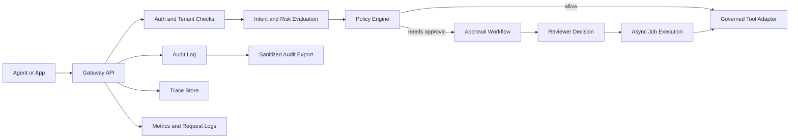

# AgentGate

AgentGate is a runtime control plane for enterprise AI agents. It intercepts agent tool calls, checks identity, intent, policy, risk, and payload sensitivity, then allows, blocks, routes for approval, audits, traces, exports, and optionally executes through governed adapters.

This repository is a production-minded monorepo for teams that want agents to use real tools without giving up runtime authorization, approval control, auditability, payload protection, and operational guardrails.
It is best positioned today as controlled-pilot ready for GitHub-first, self-hosted evaluations: treat Jira as an opt-in second phase, and keep MCP disabled by default unless the remote server is internal and tightly allowlisted.

Future Codex sessions should read [docs/AGENTGATE_CODEX_HANDOFF.md](docs/AGENTGATE_CODEX_HANDOFF.md) before making changes.

## How It Works



## Current Capabilities

- Tenant-aware FastAPI backend with JWT auth, RBAC, local login, and optional tenant-scoped OIDC/SSO foundations
- Optional browser-session hardening foundation with HttpOnly cookie mode, CSRF enforcement, and logout invalidation while preserving the existing JWT local developer flow
- Tenant-scoped identity lifecycle foundation with user deactivation/reactivation, OIDC provisioning-source tracking, and safe admin user-management APIs
- Operator-facing agent API key lifecycle surface with metadata-only listing, one-time raw secret display at creation, expiration tracking, and revoke controls
- Runtime gateway for tool calls with deterministic intent checks, risk scoring, policy evaluation, approval routing, audit logging, and trace capture
- Tenant-scoped tamper-evident audit integrity with hash chaining, verification, and safe export metadata for downstream evidence handling
- Tenant-scoped external audit checkpoint foundation with deterministic checkpoint hashes, durable checkpoint jobs, and local or S3-compatible anchor adapters that avoid storing cloud credentials in the database
- Governed adapters including mock enterprise tools, a hardened GitHub connector with local env-token auth plus optional GitHub App installation-token auth, a constrained Jira connector, and a tightly allowlisted HTTP MCP foundation
- Protected payload handling with field-level encryption, sanitized API views, retention classes, purge enforcement, and legal-hold exclusions
- Durable async jobs for Slack notifications, approved execution, audit export, retention workflows, audit-integrity verification, audit-integrity checkpointing, and connector health checks with inline local fallback, worker heartbeat, leases, stale-job recovery, and dead-letter review
- Tenant-scoped recurring scheduled task foundation that safely enqueues existing jobs for retention, audit export, audit-integrity verification, audit-integrity checkpointing, and simple connector health checks without requiring external cron for local development
- Tenant-authenticated admin settings overview for safe configuration and control-plane health visibility plus links into narrow non-secret operational controls without exposing secrets
- Operator-facing policy management surface with structured starter templates, policy review, safe enable/disable controls, and pilot-pack guidance without turning the browser into a broad policy editor
- Minimal first-run onboarding status and navigation surface so a tenant operator can safely assess setup posture and reach the first governed workflow without using raw APIs
- Dedicated tools/connectors page for safe connector posture review plus narrow non-secret metadata management without exposing raw tool config or secret-backed auth metadata
- Env-backed local key management plus an AWS KMS-backed payload-protection provider foundation with key metadata, legacy envelope compatibility, and non-sensitive key-status reporting
- Production-minded operational controls including config hardening, request logging, readiness checks, security headers, metrics, and distributed Redis-backed rate limiting with local in-memory fallback
- Starter observability assets for Prometheus scraping, Grafana dashboards, and conservative alert rules using the existing metrics surface
- Next.js admin dashboard for operators reviewing agents, approvals, traces, jobs, audit logs, retention state, audit-export status, scheduled tasks, settings, and user identity lifecycle
- Opt-in Playwright browser E2E coverage for login, onboarding, settings, tools, identity, retention, audit, and key operator navigation flows
- Separate self-hosted production deployment foundation with external Postgres, Redis, AWS KMS, worker, scheduler, and operator runbooks

## Monorepo Layout

```text
AgentGate/
  apps/
    api/        FastAPI control-plane API
    web/        Next.js admin console
  packages/
    shared/     Reserved space for shared schemas/contracts
  docs/
    ARCHITECTURE.md
    API.md
    PRODUCT.md
    ROADMAP.md
    SECURITY.md
    connectors/github.md
    integrations/slack.md
    demo-scenario.md
  docker-compose.yml
  Makefile
  .env.example
```

## Quick Start

### Option 1: Docker Compose

1. Copy `.env.example` to `.env` and adjust secrets if needed.
2. Run `docker compose up --build`.
3. In another shell, seed demo data:

```bash
docker compose exec api python -m app.db.seed
```

4. Open:
   - API: `http://localhost:8000/docs`
   - Web: `http://localhost:3000`
   - Ready: `http://localhost:8000/ready`
   - Metrics: `http://localhost:8000/metrics`
5. Optional GitHub connector auth:
   - Local/dev: set `AGENTGATE_GITHUB_TOKEN` and keep the seeded tool on `auth_mode=env_pat` or `auth_mode=env_token`.
   - Production-style: configure the GitHub tool for `auth_mode=github_app`, set `AGENTGATE_GITHUB_APP_PRIVATE_KEY`, and store only the app/installation IDs plus the private-key env/ref in tool config.
   - The default sales demo still works without either GitHub auth path.
6. Optional: enable Slack approval notifications with `AGENTGATE_SLACK_NOTIFICATIONS_ENABLED=true`, `AGENTGATE_SLACK_DEFAULT_CHANNEL=<channel-or-user-id>`, and `AGENTGATE_SLACK_BOT_TOKEN`.
7. Optional but recommended for local parity: set `AGENTGATE_PAYLOAD_ENCRYPTION_KEY` to a Fernet key. In `development` and `test`, AgentGate falls back to a deterministic local key if this is unset. Outside those environments, configure either the local env provider or AWS KMS explicitly.
   - Local/default: keep `AGENTGATE_KEY_PROVIDER=env` and set `AGENTGATE_PAYLOAD_ENCRYPTION_KEY` or `AGENTGATE_PAYLOAD_ENCRYPTION_KEY_SECRET_REF=env:AGENTGATE_PAYLOAD_ENCRYPTION_KEY`.
   - Production AWS path: set `AGENTGATE_KEY_PROVIDER=aws_kms`, `AGENTGATE_AWS_REGION`, and `AGENTGATE_AWS_KMS_KEY_ID`.
   - Optional LocalStack/testing path: also set `AGENTGATE_AWS_KMS_ENDPOINT_URL=http://localhost:4566`.
   - For manual rotation scaffolding and legacy env-envelope decrypts, add decrypt-only refs with `AGENTGATE_PAYLOAD_ENCRYPTION_ADDITIONAL_KEYS`.
8. Compose now defaults `AGENTGATE_JOB_DISPATCH_MODE=worker` and starts a dedicated `worker` service. For purely local single-process development, keep `AGENTGATE_JOB_DISPATCH_MODE=inline`.
   - In worker mode, safe worker status is available at `GET /v1/workers/status`.
9. Recurring scheduled tasks are available through `POST /v1/scheduled-tasks`, the `/scheduled-tasks` dashboard page, and the local loop command `python -m app.scheduler`.
   - In `inline` job mode, the scheduler can enqueue and execute safe recurring jobs without a separate worker process.
   - In `worker` job mode, run both `python -m app.worker` and `python -m app.scheduler`.
10. External audit checkpoints are available through `POST /v1/audit-integrity/checkpoints`, `GET /v1/audit-integrity/checkpoints`, and the `/audit-integrity` dashboard page.
   - Local development can keep `AGENTGATE_AUDIT_INTEGRITY_ANCHOR_TYPE=local`, which writes safe checkpoint documents to `AGENTGATE_AUDIT_INTEGRITY_LOCAL_PATH`.
   - Production-minded deployments should prefer `AGENTGATE_AUDIT_INTEGRITY_ANCHOR_TYPE=object_storage` with `AGENTGATE_AUDIT_INTEGRITY_S3_BUCKET`, `AGENTGATE_AUDIT_INTEGRITY_S3_REGION`, an optional `AGENTGATE_AUDIT_INTEGRITY_S3_PREFIX`, and runtime-injected secret refs or IAM instead of database-stored credentials.
   - Treat this as externally anchored tamper evidence, not as full immutability unless the destination itself enforces WORM or Object Lock semantics.
11. The dashboard page at `/settings` provides a safe read-only overview of tenant profile status, SSO state, connector health, audit export status, retention status, scheduled tasks, key provider readiness, and rate limiter status.
   - It also links operators into the narrower `/audit-exports`, `/scheduled-tasks`, and `/retention` surfaces for non-secret operational actions.
   - This settings surface is intentionally not a secret editor.
12. The dashboard page at `/onboarding` provides a safe first-run checklist for owner, admin, and security reviewer roles.
   - It shows tenant-scoped setup status, suggested next steps, links into the existing product surfaces, and narrow optional actions such as dismissing the checklist or creating a starter demo policy.
   - It does not create external connectors, inject credentials, or replace the existing agent, tool, policy, or settings APIs.
13. The dashboard page at `/tools` provides a safe operator view of configured tools and connectors.
   - It shows connector type, host, auth mode label, trust-domain hint, allowlist counts, supported actions, and health posture without exposing raw config, secret refs, env-var token names, or full base URLs.
   - It also supports narrow non-secret metadata create and edit flows for GitHub, Jira, MCP, and mock connectors.
   - It can run a safe connector health probe for owner and admin roles, but it is intentionally not a secret editor or broad generic connector wizard.
14. Tenant user lifecycle management is available through `GET /v1/users`, the `/users` dashboard page, and restricted `PATCH`, `/deactivate`, and `/reactivate` user APIs.
   - Deactivation blocks future JWT-authenticated requests, blocks new local logins, and revokes agent API keys created by that user.
   - Reactivation restores account access but does not restore previously revoked API keys.
15. Local development keeps `AGENTGATE_RATE_LIMIT_PROVIDER=in_memory` by default. For multi-instance or production-style testing, switch to `AGENTGATE_RATE_LIMIT_PROVIDER=redis`.
   - In production-like environments, Redis-backed rate limiting is the default expectation.
   - `AGENTGATE_ALLOW_IN_MEMORY_RATE_LIMIT_IN_PRODUCTION=true` exists only as an explicit escape hatch and shows up as a readiness warning.
16. Retention dry-runs are available at `/retention`. Real purge remains a privileged API operation at `POST /v1/retention/purge`.
17. OIDC/SSO is optional and disabled by default. Local username/password login remains the default path for development.
18. Browser auth can stay on the existing token flow for local development with `AGENTGATE_AUTH_SESSION_MODE=token`.
   - Production-minded browser deployments can switch to `AGENTGATE_AUTH_SESSION_MODE=cookie`, enable `AGENTGATE_COOKIE_SECURE=true`, keep `AGENTGATE_CSRF_ENABLED=true`, and optionally set `AGENTGATE_COOKIE_DOMAIN`.
   - In cookie mode, AgentGate stores the same stateless JWT in an HttpOnly cookie, requires `X-CSRF-Token` on unsafe browser requests, and keeps bearer tokens and API keys available for machine clients.
19. Audit export destinations are tenant-scoped and configured through `POST /v1/audit-exports`. The dashboard page at `/audit-exports` shows non-sensitive status plus safe enable, disable, and manual run controls only.

### Option 2: Local Development

Backend:

```bash
cd apps/api
python -m pip install -e .[dev]
python -m alembic upgrade head
python -m app.db.seed
python -m uvicorn app.main:app --reload --host 0.0.0.0 --port 8000
```

Optional worker mode:

```bash
cd apps/api
AGENTGATE_JOB_DISPATCH_MODE=worker python -m app.worker
```

Optional scheduler loop:

```bash
cd apps/api
python -m app.scheduler
```

Frontend:

```bash
cd apps/web
npm install
npm run dev
```

## Self-Hosted Production Foundation

For self-hosted production-style deployments, use the separate production Compose example instead of the local developer stack:

- `compose.prod.example.yml`
- [Self-Hosted Deployment](docs/operations/self-hosted-deployment.md)
- [Deployment Validation](docs/operations/deployment-validation.md)
- [Backup And Restore](docs/operations/backup-and-restore.md)
- [Observability Package](docs/operations/observability-package.md)
- [Production Runbook](docs/operations/production-runbook.md)
- [Production Readiness Checklist](docs/operations/production-readiness-checklist.md)

This profile assumes:

- external PostgreSQL
- external Redis
- TLS terminated by your reverse proxy or ingress
- a dedicated worker process
- a dedicated scheduler process when recurring tasks are enabled
- explicit secret injection

It is a credible self-hosted baseline, not a managed platform or compliance certification claim.

After startup or upgrade, run the deployment validator against the live stack:

```bash
make validate-deployment
```

For the local seeded demo stack:

```bash
make validate-local
```

For post-restore verification, reuse the same safe smoke validator:

```bash
make verify-restore
```

See [Backup And Restore](docs/operations/backup-and-restore.md) for backup scope, restore order, and the additional audit-integrity checks to run after the validator succeeds.

## Demo Credentials

- Tenant slug: `demo-agentgate`
- Admin: `admin@demo.agentgate.example.com` / `AgentGate123!`
- Reviewer: `reviewer@demo.agentgate.example.com` / `AgentGate123!`

These are local demo credentials only. Do not use them in any shared, staging, or production deployment.

## First-Run Onboarding

After the first login, open `/onboarding` in the web console.

- It shows safe tenant-scoped setup status for agents, tools, policies, approval coverage, audit integrity, and settings visibility.
- It routes tool setup review to `/tools`, which is a safe connector posture and metadata-management surface rather than a secret editor.
- It links operators to the existing product surfaces for agents, policies, audit integrity, settings, and the demo flow.
- It can optionally dismiss the checklist or create one starter demo policy, but it does not create connectors, inject secrets, or act as a full setup wizard.

See [Onboarding Operations Guide](docs/operations/onboarding.md) for the intended first-run flow and limitations.

## Demo And Evaluation

For a fast design-partner, investor, or technical review path, start with these docs:

- [Pilot Readiness Review](docs/reviews/PILOT_READINESS_REVIEW.md)
- [Pilot Scope](docs/reviews/PILOT_SCOPE.md)
- [Pilot Policy Pack](docs/operations/pilot-policy-pack.md)
- [Enterprise Demo Guide](docs/demo/ENTERPRISE_DEMO_GUIDE.md)
- [Design Partner Evaluation](docs/demo/DESIGN_PARTNER_EVALUATION.md)
- [API Evaluation](docs/operations/api-evaluation.md)
- [Demo Script](docs/demo/DEMO_SCRIPT.md)
- [Screenshot Checklist](docs/demo/SCREENSHOT_CHECKLIST.md)
- [Onboarding Operations Guide](docs/operations/onboarding.md)
- [Existing Demo Scenario](docs/demo-scenario.md)
- [Tool Management](docs/operations/tool-management.md)

Internal founder and operator material for design-partner outreach:

- [Design Partner Outreach](docs/go-to-market/DESIGN_PARTNER_OUTREACH.md)
- [Pre-Pilot Preflight](docs/go-to-market/PRE_PILOT_PREFLIGHT.md)
- [Pilot Rehearsal](docs/operations/pilot-rehearsal.md)

Internal private-review material:

- [Private Release Candidate Review](docs/reviews/PRIVATE_RELEASE_CANDIDATE_REVIEW.md)
- [Share Package](docs/reviews/SHARE_PACKAGE.md)

Release and versioning material:

- [Changelog](CHANGELOG.md)
- [Release Checklist](docs/operations/release-checklist.md)

For direct API review without hand-building requests, use the plain-file collection under `api-collections/http/AgentGate/`.

For controlled pilot environments, review and apply the conservative starter pack under `policy-packs/pilot-default/` before real pilot traffic. The helper scripts are documented in [Pilot Policy Pack](docs/operations/pilot-policy-pack.md).

## Common Commands

- `make bootstrap`
- `make lint`
- `make security-scan`
- `make audit-deps`
- `make verify`
- `make verify-all`
- `make prod-config-check`
- `make observability-files`
- `make observability-check`
- `make release-check`
- `make pilot-rehearsal`
- `make pilot-rehearsal-local`
- `make validate-deployment`
- `make validate-local`
- `make verify-restore`
- `make load-smoke`
- `make load-gateway`
- `make load-all`
- `make e2e-install`
- `make e2e`
- `make e2e-headed`
- `make api-dev`
- `make api-migrate`
- `make worker`
- `make api-test`
- `make api-seed`
- `make repo-secrets-check`
- `make web-dev`
- `make up`
- `make down`

## Verification

These are the repo's baseline validation commands and the same checks wired into CI:

```bash
cd apps/api
python -m compileall app
python -m pytest app/tests -q -o cache_dir=.tmp/pytest_cache

cd ../web
npm run build

cd ../..
docker compose config
```

Optional public-doc and repo-hygiene check:

```bash
python scripts/check-no-live-secrets.py
```

Optional lightweight release/package check:

```bash
make release-check
```

Extended quality and security checks:

```bash
make lint
make security-scan
make audit-deps
make verify-all
```

Optional manual load and performance regression checks:

```bash
make load-smoke
make load-gateway
make load-all
```

The k6 scripts live under `load-tests/k6/` and are documented in [Load Testing](docs/operations/load-testing.md). They are intentionally lightweight, non-blocking, and meant to catch regressions rather than claim production capacity numbers.

Optional browser E2E smoke checks:

```bash
make e2e-install
make e2e
make e2e-headed
```

The Playwright suite lives under `apps/web/e2e/` and is documented in [Browser E2E Testing](docs/operations/e2e-testing.md). It is intentionally small, uses seeded demo data, and is not part of the default blocking PR workflow.

Optional self-hosted production profile validation:

```bash
make prod-config-check
docker compose -f compose.prod.example.yml config
```

The production profile is documented in [Self-Hosted Deployment](docs/operations/self-hosted-deployment.md). Use it for external Postgres/Redis/AWS KMS style deployments without changing the local development compose flow.

Optional post-start deployment smoke validation:

```bash
make validate-deployment
```

The validator is documented in [Deployment Validation](docs/operations/deployment-validation.md). It checks health, readiness, login, and a small set of safe operator APIs without calling external connectors.

Optional pre-pilot internal rehearsal wrapper:

```bash
make pilot-rehearsal
make pilot-rehearsal-local
```

The wrapper is documented in [Pilot Rehearsal](docs/operations/pilot-rehearsal.md). It reuses the secret scan, pilot policy-pack validation, deployment validator, and required artifact checks, but it does not replace a production-style rehearsal or restore drill.

Optional post-restore recovery verification:

```bash
make verify-restore
```

The full recovery sequence is documented in [Backup And Restore](docs/operations/backup-and-restore.md). PostgreSQL is the durable system of record, but external audit-anchor storage, secret-manager state, and KMS access still need to be recovered separately.

Optional observability starter assets:

```bash
make observability-files
make observability-check
```

The starter monitoring package is documented in [Observability Package](docs/operations/observability-package.md). Keep `/metrics` internal-only even though the metric surface is sanitized.

## Release Naming

AgentGate uses lightweight pre-1.0 tags in the form `v0.x.y`.

A `controlled-pilot release` means a curated pre-1.0 release intended for private reviewers, design partners, and narrow self-hosted pilot work. It does not mean enterprise GA, managed SaaS maturity, compliance readiness, or default immutability.

Use [CHANGELOG.md](CHANGELOG.md) for high-level release notes and [Release Checklist](docs/operations/release-checklist.md) for the pre-tag process.

## Quality And Security Tooling

AgentGate keeps the automated tooling practical rather than maximally noisy.

Current repo tooling:

- `Dependabot` opens grouped update PRs for GitHub Actions, backend Python dependencies, frontend npm dependencies, and Docker base images.
- `Ruff` checks backend Python for conservative correctness-focused lint issues.
- `Bandit` scans `apps/api/app` for high-confidence Python security issues and excludes tests.
- `pip-audit` audits installed backend Python dependencies.
- `npm audit --audit-level=high` checks the frontend dependency tree for high and critical issues.
- `Trivy` runs a filesystem scan for high and critical dependency vulnerabilities plus misconfigurations.
- `Gitleaks` remains the dedicated secret scanner.

Blocking vs advisory:

- Blocking in CI: existing backend compile and tests, frontend build, Docker Compose validation, Ruff, Bandit, `npm audit` high+, Trivy high and critical findings, and Gitleaks.
- Advisory in CI: `pip-audit` currently runs as informational because Python advisory severity filtering is not clean enough to make it a low-noise hard gate yet.

Local commands:

- `cd apps/api && python -m ruff check app`
- `cd apps/api && python -m bandit -c bandit.yaml -r app -iii`
- `cd apps/api && python -m pip_audit --progress-spinner off`
- `cd apps/web && npm audit --audit-level=high`
- `trivy fs --config .trivy.yaml .`

False-positive handling:

- Prefer fixing the underlying issue first.
- For Bandit, use targeted `# nosec <rule>` comments with a short rationale instead of broad disables.
- For Ruff, prefer targeted per-file ignores over repo-wide rule suppression.
- For dependency and Trivy findings, verify the vulnerable path and fix or pin deliberately before adding any temporary exception.

Automated scanners help catch regressions early, but they do not replace the threat model, code review, architecture review, or manual security testing.

## Security And Repo Hygiene

- Never commit `.env` files, real tokens, cookies, protected payloads, or customer data.
- Never commit database dumps, backup archives, or recovery exports into the repo.
- Keep all example secrets in docs and tests obviously fake and sanitized.
- Do not place raw GitHub tokens, GitHub App private keys, or Slack secrets in tool configuration records. Inject them through the runtime environment or a secret manager.
- Keep `/metrics` on an internal network path even though it only exposes safe aggregate metrics.
- Run `python scripts/check-no-live-secrets.py` before public pushes that touch docs, examples, or workflows.
- Run `make verify-all` before large or security-sensitive changes when your local environment has the required dev tools installed.
- Use the public [Security Policy](SECURITY.md) for disclosure guidance. Do not post live vulnerabilities in public issues.
- Built-in audit integrity is tamper-evident inside AgentGate's primary datastore. External checkpoints improve evidence survivability outside that boundary, but they are still not a valid immutability claim unless the destination itself enforces WORM or Object Lock semantics.

## Key Docs

- [Security Policy](SECURITY.md)
- [Architecture](docs/ARCHITECTURE.md)
- [API](docs/API.md)
- [Security](docs/SECURITY.md)
- [Codex Handoff](docs/AGENTGATE_CODEX_HANDOFF.md)
- [Threat Model](docs/security/THREAT_MODEL.md)
- [Security Review Checklist](docs/security/SECURITY_REVIEW_CHECKLIST.md)
- [Incident Response](docs/security/INCIDENT_RESPONSE.md)
- [Pilot Readiness Review](docs/reviews/PILOT_READINESS_REVIEW.md)
- [Pilot Scope](docs/reviews/PILOT_SCOPE.md)
- [Audit Integrity](docs/security/audit-integrity.md)
- [External Audit Anchoring](docs/security/external-audit-anchoring.md)
- [Payload Protection](docs/security/payload-protection.md)
- [Key And Secret Management](docs/security/key-and-secret-management.md)
- [Agent API Keys](docs/security/agent-api-keys.md)
- [SSO And OIDC](docs/security/sso-oidc.md)
- [Identity Lifecycle](docs/security/identity-lifecycle.md)
- [Session Hardening](docs/security/session-hardening.md)
- [Retention And Purge](docs/security/retention-and-purge.md)
- [Audit Export](docs/integrations/audit-export.md)
- [Product](docs/PRODUCT.md)
- [Roadmap](docs/ROADMAP.md)
- [Demo Scenario](docs/demo-scenario.md)
- [Jobs And Workers](docs/operations/jobs-and-workers.md)
- [Job Reliability](docs/operations/job-reliability.md)
- [Deployment Hardening](docs/operations/deployment-hardening.md)
- [Self-Hosted Deployment](docs/operations/self-hosted-deployment.md)
- [Production Runbook](docs/operations/production-runbook.md)
- [Production Readiness Checklist](docs/operations/production-readiness-checklist.md)
- [Admin Settings](docs/operations/admin-settings.md)
- [Policy Management](docs/operations/policy-management.md)
- [Onboarding Operations Guide](docs/operations/onboarding.md)
- [API Evaluation](docs/operations/api-evaluation.md)
- [Tool Management](docs/operations/tool-management.md)
- [Observability](docs/operations/observability.md)
- [Observability Package](docs/operations/observability-package.md)
- [Load Testing](docs/operations/load-testing.md)
- [Browser E2E Testing](docs/operations/e2e-testing.md)
- [Rate Limiting](docs/operations/rate-limiting.md)
- [Scheduled Tasks](docs/operations/scheduled-tasks.md)
- [GitHub Connector](docs/connectors/github.md)
- [Slack Notifications](docs/integrations/slack.md)
- [Contributing](CONTRIBUTING.md)

## Roadmap Snapshot

- Proxy-aware client IP trust and richer per-key abuse policies
- Deeper production observability and alerting beyond the starter package
- Broader cloud KMS and external secret manager providers
- Lease renewal and stronger distributed job orchestration beyond the built-in scheduler loop
- SAML, broader SCIM coverage, and richer enterprise identity lifecycle controls

The fuller roadmap lives in [docs/ROADMAP.md](docs/ROADMAP.md).

## Security Disclaimer

AgentGate is a strong enterprise runtime-governance foundation, not a claim of complete cloud-platform hardening. This repository includes meaningful security controls, including tenant-scoped tamper-evident audit chaining, but it still expects operators to bring TLS termination, secret management, deployment isolation, monitoring, backup strategy, and environment-specific governance.

## Known Limitations

This repo is a strong production-oriented foundation, not a completed enterprise platform. It now includes optional tenant-scoped OIDC login, cookie-session hardening, tenant-scoped user lifecycle controls, a minimal SCIM Users foundation, GitHub App installation-token auth alongside governed Jira and MCP connector foundations, env-backed local key management, an AWS KMS-backed payload-protection provider foundation, tenant-scoped audit export, tenant-scoped tamper-evident audit chaining, an external audit-checkpoint foundation with local or S3-compatible anchors, job leases and stale recovery, a built-in recurring scheduler foundation, readiness and metrics foundations, Redis-backed distributed endpoint rate limiting with in-memory local fallback, observability starter assets, an API evaluation collection, lightweight k6 regression scripts, a small Playwright browser E2E smoke suite, backup/restore guidance, and a Compose-based self-hosted production deployment profile, but it does not currently include SAML, broad SCIM identity-governance coverage, guaranteed immutable audit storage without destination-side WORM controls, proxy-aware client IP trust, advanced per-API-key abuse policy, lease renewal for long-running jobs, full observability infrastructure, fully managed worker orchestration, GCP/Azure/Vault key providers, automatic key rewrap workflows, tenant-scoped key hierarchies, tenant-managed GitHub App installation discovery, Kubernetes or Terraform deployment assets, or certified compliance controls. Those are documented as next-step hardening work rather than claimed as complete.
